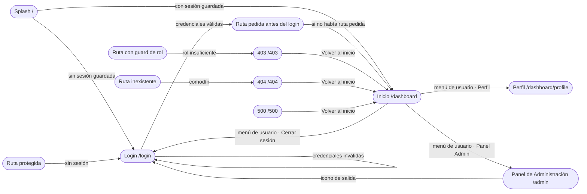
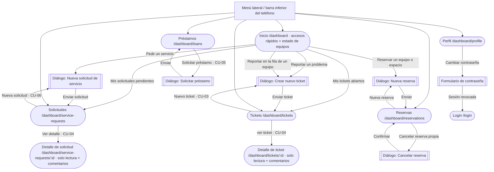
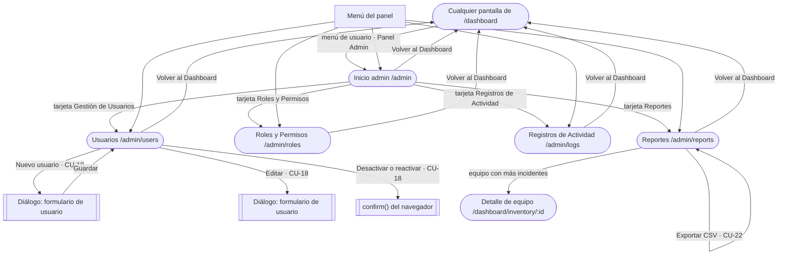

# Lux — Flujo de navegación por actor

Cómo se mueve cada actor entre las pantallas de Lux (SGRSI): qué ve en el menú, desde dónde llega a
cada pantalla y qué acción dispara cada navegación.

> **Revisión:** 21 de octubre de 2026.
> **Rama:** `dev`.
> **Commit de referencia:** `e9175a5da6a207691c450286065d0aa05001b64e` (merge del PR #52).
> **Fuentes verificadas:** `src/router/index.tsx`, `src/components/layout/navItems.ts`,
> `src/components/layout/{Sidebar,Topbar,TabBar,AdminLayout}.tsx`, `src/lib/constants.ts` (`ROUTES`),
> `src/lib/roles.ts` y las pantallas de `src/features/**`.

Los actores y los números de caso de uso (CU) son los del vault
(`eternum-vault/02-INGENIERIA-SOFTWARE/E2/UML-CasosDeUso.md`). Este documento reemplaza la guía
publicada originalmente en el issue #48: al final se listan las diferencias que se encontraron
contra el código actual.

**Convenciones de los diagramas**

- Rectángulo redondeado (stadium): pantalla con ruta propia.
- Doble borde (`[[...]]`): formulario o diálogo que se abre **encima** de otra pantalla; no tiene ruta.
- Cada flecha lleva la acción que dispara la navegación.
- Los bloques se pueden pegar en <https://mermaid.live>.

---

## 0. Tramo común a todos los actores (entrada y salida)

| Desde | Acción | Hacia |
|---|---|---|
| `/` Splash | tras 1,8 s, sin sesión guardada | `/login` |
| `/` Splash | tras 1,8 s, con sesión guardada | `/dashboard` (Inicio) |
| `/login` | credenciales válidas (CU-01) | la ruta que se quería abrir antes del login o `/dashboard` |
| `/login` | credenciales inválidas | `/login` con mensaje de error; a partir del tercer intento aparece un aviso de intentos |
| `/login` | cuenta bloqueada por intentos | `/login` con el mensaje de bloqueo del servidor |
| Cualquier ruta protegida | sin sesión | `/login`, recordando la ruta de origen |
| Ruta con guard de rol | sesión con rol insuficiente | `/403` |
| Ruta inexistente | — | `/404` (comodín que redirige) |
| Error de servidor | — | `/500` (ruta directa; no hay redirección automática) |
| Menú de usuario (topbar) | "Perfil" | `/dashboard/profile` |
| Menú de usuario (topbar) | "Panel Admin" (solo admin y raíz) | `/admin` |
| Menú de usuario (topbar) | "Cerrar sesión" (CU-02) | `/login` |
| Barra del panel admin | icono de salida | `/login` |
| 403 / 404 / 500 | "Volver al inicio" | `/dashboard` |

Notas verificadas:

- El login recuerda únicamente el `pathname` de la ruta de origen: si la ruta tenía query string
  (por ejemplo `?nuevo=1`), esa parte no se conserva.
- `/wait` existe en el router (`WaitToLogin`), pero **ninguna pantalla enlaza a ella**. Si se abre a
  mano, con sesión redirige a `/dashboard`; sin sesión, a `/login` después de 8 s. Es una ruta
  huérfana.

---

## 1. Solicitante

**Menú** (escritorio y barra inferior del teléfono): Inicio · Tickets · Préstamos · Solicitudes ·
Reservas · Perfil. No ve Inventario, Estado de Equipos, Ubicaciones ni el panel de administración.

**Inicio** (`RequesterHome`, en `/dashboard`):

- Tres accesos rápidos que abren el diálogo de alta dentro de la lista correspondiente:
  - *Reportar un problema* → `/dashboard/tickets?nuevo=1`
  - *Pedir un servicio* → `/dashboard/service-requests?nuevo=1`
  - *Reservar un equipo o espacio* → `/dashboard/reservations?nuevo=1`
- Dos tarjetas de actividad: *Mis tickets abiertos* → Tickets y *Mis solicitudes pendientes* →
  Solicitudes.
- Debajo, la sección **Estado de los equipos**: listado paginado (8 por página) con búsqueda y
  filtros por ubicación y estado. Cada fila tiene *Reportar* → `/dashboard/tickets?nuevo=1&equipo=<id>`,
  que abre el diálogo de ticket con ese equipo ya elegido.

| Pantalla | Qué hace ahí | CU |
|---|---|---|
| Tickets | Ve **solo los suyos**; "Nuevo ticket" abre un diálogo (título, descripción, categoría, equipo opcional con escaneo de QR) | CU-03, CU-04 |
| Detalle de ticket | Solo lectura del estado, diagnóstico y trabajo realizado; puede comentar | CU-04 |
| Solicitudes | Ve solo las suyas; "Nueva solicitud" abre un diálogo | CU-06, CU-04 |
| Detalle de solicitud | Sigue el estado y comenta; no puede asignar ni cambiar el estado | CU-04 |
| Préstamos | Ve solo los suyos; "Solicitar préstamo" abre un diálogo con los equipos disponibles y las fechas de entrega y devolución | CU-05 |
| Reservas | Ve las suyas; "Nueva reserva" abre un diálogo; puede cancelar la suya mientras esté pendiente o aprobada y no haya empezado | (sin CU en el vault) |
| Perfil | Datos personales, cambio de contraseña y accesibilidad (tema, idioma, tamaño, contraste, fuente disléxica) | — |

Al cambiar la contraseña, la API revoca las sesiones y la aplicación cierra la sesión a los 2,5 s.

---

## 2. Técnico

**Menú**: Inicio · Inventario · Estado de Equipos · Ubicaciones · Tickets · Préstamos · Solicitudes ·
Reservas · Perfil. En el teléfono, la barra inferior muestra Inicio · Inventario · Tickets · Préstamos ·
Solicitudes · Reservas · Perfil (7 secciones; quedan afuera Estado de Equipos y Ubicaciones).

**Inicio** (panel del staff):

- **Trabajo del área** (cola de trabajo), con una tarjeta por pendiente:
  - *Tickets sin tomar* → `/dashboard/tickets/ool`
  - *Tickets en curso* → `/dashboard/tickets`
  - *Solicitudes a responder* → `/dashboard/service-requests`
  - *Préstamos vencidos* → `/dashboard/loans`
  - *Equipos en reparación* → `/dashboard/equipment-status` (abre la pantalla completa; no aplica un
    filtro por estado)
- Cuatro métricas, dos gráficos y el bloque "Estado del sistema", con selector de período (7/30/90 días).
- **Exportar CSV** solo lo ven los administradores; el técnico ve las métricas y los gráficos, pero no
  el botón.

| Pantalla | Acciones / navegación | CU |
|---|---|---|
| Inventario | Alta de equipo (`/dashboard/inventory/nuevo`), alta de componente (`/dashboard/inventory/nuevo-componente`), acceso a Ubicaciones, ver detalle de equipo o componente | CU-07, CU-08 |
| Detalle de equipo | Editar (`/dashboard/inventory/:id/editar`), dar de baja (diálogo), registrar/editar intervenciones, ver historial | CU-08, CU-09, (CU-10/CU-14 ≈ intervenciones) |
| Detalle de componente | Editar (`/dashboard/inventory/componente/:id/editar`) y dar de baja (diálogo) | CU-08 |
| Estado de Equipos | Gráficos por ubicación e incidentes, y tabla de equipos con estado y fallas; sin acciones | CU-07 |
| Ubicaciones | Alta, edición y baja de ubicaciones; la baja se bloquea si la ubicación tiene equipos | — |
| Tickets | Todos los tickets; botón OOL; por defecto oculta los resueltos (se ven filtrando por estado o buscando por ID) | — |
| Tickets sin asignar (OOL) | "Tomar" reclama el ticket y lo saca de la cola; para abrirlo hay que entrar por el título | CU-11 |
| Detalle de ticket | Tomar, liberar, pasar a resolución, reabrir; asistente de 5 pasos (Incidente → Estado del equipo → Historial → Diagnóstico → Resumen) y "Marcar como completado", que exige diagnóstico e indicar si se corrigió | CU-11, CU-12, CU-13 |
| Préstamos | Registrar, aprobar, rechazar, entregar y registrar devolución; no hay pantalla de detalle | CU-15, CU-16 (y CU-19 en la práctica) |
| Solicitudes → detalle | Tomar, asignar técnico, cambiar estado, comentar | CU-17 (y CU-20 en la práctica) |
| Reservas | Aprobar, rechazar y modificar cualquier reserva; **cancelar solo las propias** (la cancelación de una reserva ajena la hace su dueño); columna de solicitante | — |

```mermaid
flowchart TD
    IN(["Inicio /dashboard · cola de trabajo + métricas"])
    IN -->|"Tickets sin tomar"| OOL(["Tickets sin asignar /dashboard/tickets/ool"])
    IN -->|"Tickets en curso"| TK(["Tickets /dashboard/tickets"])
    IN -->|"Solicitudes a responder"| SV(["Solicitudes /dashboard/service-requests"])
    IN -->|"Préstamos vencidos"| PR(["Préstamos /dashboard/loans"])
    IN -->|"Equipos en reparación"| ES(["Estado de Equipos /dashboard/equipment-status"])

    MENU["Menú lateral"]
    MENU --> IN
    MENU --> INV(["Inventario /dashboard/inventory"])
    MENU --> ES
    MENU --> UB(["Ubicaciones /dashboard/locations"])
    MENU --> TK
    MENU --> PR
    MENU --> SV
    MENU --> RS(["Reservas /dashboard/reservations"])
    MENU --> PF(["Perfil /dashboard/profile"])

    INV -->|"Nuevo equipo · CU-08"| EQN[["Formulario de equipo"]]
    INV -->|"Nuevo componente · CU-08"| CPN[["Formulario de componente"]]
    INV -->|"Ubicaciones"| UB
    INV -->|"ver equipo"| EQD(["Detalle de equipo /dashboard/inventory/:id"])
    EQD -->|"Editar · CU-08"| EQE[["Formulario de equipo"]]
    EQD -->|"Dar de baja · CU-09"| BAJA[["Diálogo: dar de baja"]]
    EQD -->|"Registrar intervención"| INT[["Diálogo: intervención"]]
    EQN -->|"Guardar"| INV

    INV -->|"ver componente"| CPD(["Detalle de componente /dashboard/inventory/componente/:id"])
    CPD -->|"Editar"| CPE[["Formulario de componente"]]
    CPD -->|"Dar de baja"| BAJAC[["Diálogo: dar de baja"]]

    UB -->|"Alta o edición"| UBF[["Diálogo: ubicación"]]
    UB -->|"Baja"| UBD[["Diálogo: eliminar ubicación"]]

    TK -->|"OOL"| OOL
    TK -->|"ver ticket"| TKD(["Detalle de ticket /dashboard/tickets/:id · asistente"])
    OOL -->|"Tomar · CU-11"| OOL
    OOL -->|"ver ticket"| TKD
    TKD -->|"Tomar / liberar / cambiar estado / completar · CU-11 a CU-13"| TKD

    PR -->|"Registrar préstamo"| PRN[["Diálogo: registrar préstamo"]]
    PR -->|"Aprobar"| PR
    PR -->|"Rechazar"| PRR[["Diálogo: rechazar préstamo"]]
    PR -->|"Registrar entrega · CU-15"| PR
    PR -->|"Devolver · CU-16"| PRD[["Diálogo: registrar devolución"]]

    SV -->|"Ver detalle"| SVD(["Detalle de solicitud /dashboard/service-requests/:id"])
    SVD -->|"Tomar / asignar técnico / cambiar estado / comentar · CU-17"| SVD

    RS -->|"Aprobar"| RS
    RS -->|"Rechazar"| RSR[["Diálogo: rechazar reserva"]]
    RS -->|"Modificar"| RSF[["Diálogo: modificar reserva"]]
    RS -->|"Cancelar (solo propias)"| RSC[["Diálogo: cancelar reserva"]]
```

---

## 3. Administrador

Tiene **todo lo del técnico** (mismo menú y mismas pantallas) y, además, la entrada **"Panel Admin"**
en el menú de usuario de la barra superior. Esa entrada solo aparece para `admin` y `root_admin`.

**Panel de Administración** (`/admin`, layout propio):

- En escritorio, menú lateral propio; en el teléfono, una fila de secciones que se desplaza de costado.
- Inicio admin · Usuarios · Roles y Permisos · Registros de Actividad · Reportes.
- "Volver al Dashboard" en el menú (y una flecha en la cabecera en el teléfono).
- Icono de cerrar sesión en la cabecera.

| Pantalla | Acciones | CU |
|---|---|---|
| Inicio admin | Cuatro tarjetas de acceso: Gestión de Usuarios, Roles y Permisos, Registros de Actividad y Reportes | — |
| Usuarios | Buscar y filtrar por rol; crear usuario (diálogo); editar (diálogo); desactivar o reactivar con `confirm()` del navegador | CU-18 |
| Roles y Permisos | Matriz de permisos por rol, solo consulta | — |
| Registros de Actividad | Log de quién hizo qué, con búsqueda; también lo ve el Administrador | CU-24 (en el vault es solo del raíz) |
| Reportes | Préstamos vencidos, tiempos de resolución e incidentes por equipo; cada tarjeta exporta CSV y los equipos enlazan a su detalle de inventario | CU-22 |

---

## 4. Administrador raíz

Navega **exactamente igual que el Administrador**: mismo menú, mismo panel y mismas pantallas. La
diferencia está en las acciones sobre usuarios:

- La fila del raíz se puede editar, pero **no desactivar**.
- Ningún administrador puede editar ni desactivar la cuenta raíz; solo el propio raíz puede editarla.
- Nadie puede desactivar su propia cuenta (esto vale para todos los roles).
- El rol `root_admin` no se ofrece al crear usuarios ni se puede asignar desde el formulario.

> Según el vault, el raíz tendría además CU-24 *Auditar sistema* (exclusivo) y CU-25 *Gestionar cuentas
> administrativas*. Hoy el log también lo ve el Administrador y no existe una pantalla aparte para las
> cuentas administrativas; ambas cosas se hacen desde Usuarios.

---

## 5. Reloj

Es un actor sin interfaz, así que **no tiene flujo de navegación**. Sus casos (CU-26 *Vencer préstamo* y
CU-27 *Expirar sesión*) se ven solo como efectos:

- Un préstamo pasa a "Vencido" y aparece en Préstamos, en la tarjeta *Préstamos vencidos* del inicio del
  staff y en Reportes.
- Una sesión vencida o revocada deja de ser válida: al volver a la pestaña, `useAuth` consulta `me` y,
  si ya no hay sesión, cierra la sesión local; la próxima ruta protegida lleva a `/login`.

---

## 6. Resumen: qué secciones ve cada actor

| Sección | Solicitante | Técnico | Administrador | Adm. raíz |
|---|:-:|:-:|:-:|:-:|
| Inicio | Accesos rápidos + estado de equipos | Cola de trabajo + métricas | Cola de trabajo + métricas | Cola de trabajo + métricas |
| Inventario | No está en el menú; la ruta abre igual (sin guard) | ✔ | ✔ | ✔ |
| Estado de Equipos | No está en el menú; la ruta abre igual (sin guard) | ✔ | ✔ | ✔ |
| Ubicaciones | — (ruta con guard de staff) | ✔ | ✔ | ✔ |
| Tickets | Los suyos | Todos + OOL | Todos + OOL | Todos + OOL |
| Préstamos | Los suyos | Todos | Todos | Todos |
| Solicitudes | Las suyas | Todas | Todas | Todas |
| Reservas | Las suyas | Todas | Todas | Todas |
| Perfil | ✔ | ✔ | ✔ | ✔ |
| Panel de Administración | — | — | ✔ | ✔ |
| Ayuda / onboarding | No existe | No existe | No existe | No existe |

**Menú por rol y cantidad de entradas**

| Rol | Menú lateral | Barra inferior (teléfono) |
|---|---|---|
| Solicitante | 6: Inicio, Tickets, Préstamos, Solicitudes, Reservas, Perfil | 6 (las mismas) |
| Técnico | 9: + Inventario, Estado de Equipos, Ubicaciones | 7: Inicio, Inventario, Tickets, Préstamos, Solicitudes, Reservas, Perfil |
| Administrador | 9 (las del técnico) | 7 (las del técnico) |
| Adm. raíz | 9 (las del técnico) | 7 (las del técnico) |

Las secciones Tickets, Préstamos, Solicitudes y Reservas muestran un punto cuando tienen avisos sin ver
(en el menú lateral, sobre el icono; también en la barra inferior).

---

## 7. Rutas reales y guards

| Ruta | Guard | Pantalla |
|---|---|---|
| `/` | público | Splash |
| `/login` | público | Login |
| `/wait` | público, sin enlaces | WaitToLogin (huérfana) |
| `/dashboard` | sesión | Inicio (staff o solicitante según rol) |
| `/dashboard/inventory` | sesión, **sin rol** | Inventario |
| `/dashboard/inventory/nuevo` | staff | Formulario de equipo |
| `/dashboard/inventory/nuevo-componente` | staff | Formulario de componente |
| `/dashboard/inventory/:id` | sesión, **sin rol** | Detalle de equipo |
| `/dashboard/inventory/:id/editar` | staff | Edición de equipo |
| `/dashboard/inventory/componente/:id` | sesión, **sin rol** | Detalle de componente |
| `/dashboard/inventory/componente/:id/editar` | staff | Edición de componente |
| `/dashboard/equipment-status` | sesión, **sin rol** | Estado de Equipos |
| `/dashboard/locations` | staff | Ubicaciones |
| `/dashboard/tickets` | sesión | Tickets |
| `/dashboard/tickets/:id` | sesión | Detalle de ticket |
| `/dashboard/tickets/ool` | staff | Tickets sin asignar |
| `/dashboard/loans` | sesión | Préstamos |
| `/dashboard/service-requests` | sesión | Solicitudes |
| `/dashboard/service-requests/:id` | sesión | Detalle de solicitud |
| `/dashboard/reservations` | sesión | Reservas |
| `/dashboard/profile` | sesión | Perfil |
| `/admin` y `/admin/*` | admin o raíz | Panel de Administración |
| `/403`, `/404`, `/500` | público | Páginas de error |

`staff` = `root_admin`, `admin`, `tecnico`. `admin` = `root_admin`, `admin` (`src/lib/roles.ts`).
La ruta comodín `*` redirige a `/404`.

---

## 8. Diferencias detectadas

El issue #48 se escribió sobre `dev` al 11 de octubre. Estas son las afirmaciones que ya no coinciden
con el código al 21 de octubre:

| El issue decía | Hoy en `dev` |
|---|---|
| Las altas de ticket, solicitud y reserva eran pantallas/formularios de ruta propia | Son **diálogos dentro de la lista**. Los accesos rápidos abren la lista con `?nuevo=1`; no existe una ruta de alta |
| "Tickets sin tomar" apuntaba a `/tickets/ool` | La ruta real es `/dashboard/tickets/ool` |
| "Tomar" en OOL llevaba al detalle del ticket | "Tomar" reclama y recarga la cola; el ticket se abre desde su título (y desde el detalle, si sigue pendiente, se puede tomar) |
| El inicio del solicitante tenía 3 accesos rápidos y 2 tarjetas | Además incluye **Estado de los equipos**: listado paginado con filtros y un botón *Reportar* por equipo que abre el ticket con `equipo=<id>` |
| El técnico veía "Exportar" en el inicio | El botón **Exportar CSV** es solo para administradores |
| La barra inferior mostraba "las mismas secciones, sin Estado de equipos ni Ubicaciones" | Para el solicitante tampoco está Inventario (6 secciones); para el staff sí está Inventario (7). Quedan afuera solo Estado de Equipos y Ubicaciones |
| El menú de usuario decía "Panel de administración" | El texto real es **"Panel Admin"** |
| Desactivar un usuario abría un diálogo de confirmación | Usa el `confirm()` nativo del navegador; no hay diálogo propio |
| El detalle de componente solo permitía editar | También permite **dar de baja** |
| `/dashboard/inventory` estaba "oculta en el menú" | Está oculta a propósito (`staffOnly`) y sigue **sin restricción de rol**, como decía el issue. Se sumó el mismo caso en `/dashboard/equipment-status`, que tampoco tiene guard |
| "Ruta de otro rol → `/403`" | Solo para rutas con `roles` explícito. Inventario, Estado de Equipos, los detalles de inventario y el detalle de ticket no tienen guard; el acceso se controla dentro de la pantalla (botones y acciones) |
| El técnico podía "cancelar" reservas | Puede aprobar, rechazar y modificar cualquier reserva, pero **cancelar solo las propias**: la API rechaza la cancelación de una reserva ajena y la interfaz solo muestra el botón al dueño |
| Estado de Equipos era una "vista por estado (disponible, en uso, en reparación)" | Es una pantalla con gráficos por ubicación e incidentes y una tabla de equipos con su estado; no hay filtro ni vistas separadas por estado |
| El solicitante solo podía cancelar su reserva | Correcto, y **tampoco puede modificarla**: cancelar (pendiente o aprobada, antes de empezar) es su única acción; modificar es del staff |
| Usuarios solo permitía desactivar | También permite **reactivar** una cuenta desactivada, con el mismo `confirm()` |
| Préstamos tenía "registrar, aprobar, rechazar, entregar, devolver" | Correcto, pero **no hay pantalla de detalle**: todo se hace desde la tabla |
| El panel admin mostraba "Indicadores y exportar CSV" | Son tres tarjetas (vencidos, resolución, equipos con más incidentes), cada una con su CSV |
| El log era exclusivo del raíz (CU-24) | Lo ven **Administrador y raíz**; no hay pantalla separada de cuentas administrativas |

Otras observaciones de la revisión:

- La **matriz de Roles y Permisos** no coincide con la navegación real: marca `view_inventory` para
  todos los roles (incluido solicitante), pero Inventario no está en el menú del solicitante; y marca
  `view_loans` solo para staff, pero el solicitante sí ve Préstamos (los suyos).
- El inicio del solicitante muestra el estado de los equipos y permite reportar desde ahí, lo que en la
  práctica cubre parte de CU-07 aunque la ruta `/dashboard/inventory` siga fuera del menú.
- No existen rutas ni entradas de menú de **ayuda u onboarding** en `dev`.
- `/wait` está en el router pero no se usa; no aparece en ningún enlace.

---

## 9. Pendientes y decisiones abiertas

1. **Inventario para el solicitante (CU-07).** Decidir si se agrega Inventario al menú del solicitante o
   si se cierra `/dashboard/inventory` con `ProtectedRoute roles={STAFF_ROLES}`. Hoy la ruta está
   abierta y el menú la oculta.
2. **Estado de Equipos.** Tiene el mismo problema que Inventario: no está en el menú del solicitante
   pero la ruta no tiene guard. Conviene resolverlo junto con el punto anterior.
3. **Matriz de Roles y Permisos.** Alinear `RolesConfig` con `navItemsFor` y con los guards reales
   (`view_inventory`, `view_loans`).
4. **Menú de usuario.** Unificar el texto "Panel Admin" con el nombre usado en la documentación ("Panel
   de Administración") si se quiere evitar ambigüedad.
5. **OOL.** Evaluar si "Tomar" debe navegar al detalle en vez de quedarse en la cola.
6. **Exportar en el inicio del staff.** Decidir si el técnico debe poder exportar o si el botón queda
   exclusivo de administradores (comportamiento actual).
7. **`/wait`.** Enlazarla desde el login (por ejemplo, mientras se valida la sesión) o eliminarla.
8. **Ayuda / onboarding.** Si se planifica, crear la ruta y la entrada de menú, y actualizar este
   documento y la tabla del punto 6.
9. **Reservas del solicitante.** Evaluar si puede modificar (no solo cancelar) una reserva propia antes
   de que empiece.
