# SGRSI / Lux — Diagramas de secuencia del *happy path* (CU-01 a CU-27)

> **Documento versionado.** Reemplaza la guía publicada en el issue
> [#47](https://github.com/wefaber/lux/issues/47). El contenido sustantivo es el mismo:
> las 27 secuencias del camino feliz con su bloque Mermaid.
>
> **Última revisión:** 2026-10-21 · **Referencia:** rama `docs/47-uml-sequences` desde
> `origin/dev` @ `e9175a5` · **Fuente del modelo:** vault `eternum-vault`
> (`02-INGENIERIA-SOFTWARE/E2/`).

---

## 1. Alcance y fuentes

*Happy path* = el **flujo principal** de cada planilla, sin flujos alternativos. Se dibuja
como **diagrama de secuencia del sistema** (DSS): el actor, el sistema como caja negra y los
casos factorizados (CU-R, CU-N, CU-V) como pasos internos del sistema.

El documento cubre **una secuencia por caso de uso, CU-01 a CU-27**. Los diagramas de casos
de uso por actor ya existen en el vault (`07-ASSETS/Diagramas/`, SVG, PNG y JSON por actor):
esto es lo que falta dibujar.

Fuentes, en orden de autoridad:

1. `02-INGENIERIA-SOFTWARE/E2/UML-CasosDeUso.md`: actores, CU-01 a CU-27, `include`/`extend`
   y planillas.
2. `02-INGENIERIA-SOFTWARE/E2/UML-Estados.md`: nombres de los estados.
3. El código de `dev` **no** define los diagramas: solo se usa en la sección 5 para marcar
   dónde la implementación difiere del modelo, y para mapear cada caso a la operación real
   de la API.

> Los bloques Mermaid se pueden pegar en <https://mermaid.live> y después terminarlos en
> draw.io con el estilo de `07-ASSETS/Diagramas/PorActor/`.

---

## 2. Convenciones

### 2.1 Cómo se dibuja

| Elemento | Cómo se dibuja |
|---|---|
| Actor humano | Muñequito con el nombre del actor (Solicitante, Técnico, Administrador, Administrador raíz) |
| Reloj | Actor con estereotipo `<<temporal>>` o un ícono de reloj; no tiene sesión |
| Sistema | Una sola línea de vida: **`:SGRSI`** |
| Mensaje del actor | Flecha sólida actor → `:SGRSI` |
| Respuesta | Flecha punteada `:SGRSI` → actor |
| Paso interno | Auto-mensaje sobre `:SGRSI` |
| `include` CU-R / CU-N / CU-V | Auto-mensaje con el nombre del caso, p. ej. `«include» CU-R Registrar en auditoría` |
| Precondición | Nota UML arriba a la izquierda, **fuera** del sistema (igual que en los diagramas de casos de uso) |

**Login:** no se dibuja dentro de cada secuencia. La sesión es una **precondición**, no un
`include` (lo justifica la sección 2.1 del vault). Todos los diagramas salvo CU-01 llevan solo
la nota "Sesión iniciada y vigente (CU-01)"; CU-01, que es el propio login, lleva la
precondición de la cuenta vigente.

Los nombres de operación de los diagramas (`reportarIncidencia`, `autorizar`, `resolver`, …)
son **conceptuales**: el DSS muestra el sistema como caja negra, no la API. La
correspondencia con las operaciones GraphQL reales está en la sección 5.2.

### 2.2 Nombres de estado: modelo y código

El modelo usa nombres en español; el código usa enums en inglés (`src/lib/constants.ts` y
`api/src/lib/types.ts`). Los diagramas siguen al modelo.

| Modelo (vault) | Código |
|---|---|
| pendiente | `pending` |
| en_proceso | `in_progress` |
| en_resolucion | `in_resolution` |
| resuelto | `resolved` |
| aprobado / aprobada | `approved` |
| activo / activa | `active` |
| vencido | `overdue` |
| devuelto | `returned` |
| rechazado / rechazada | `rejected` |
| completada | `completed` |
| cancelada | `cancelled` |
| disponible | `available` |
| en_uso | `in_use` |
| en_reparacion | `in_repair` |
| de_baja | `retired` |

Ciclos vigentes en el modelo:

- **Ticket:** pendiente → en_proceso → en_resolucion → resuelto.
- **Préstamo:** pendiente → aprobado → activo → devuelto (además vencido y rechazado).
- **Equipo:** disponible, en_uso, en_reparacion, de_baja.
- **Solicitud de servicio:** pendiente → aprobada → en_proceso → completada (además rechazada).

---

## 3. Actores

| Actor | Generaliza a | Rol en el código | Etiqueta en la UI | Casos propios |
|---|---|---|---|---|
| Solicitante | — | `solicitante` | Solicitante | CU-01 a CU-07 |
| Técnico | Solicitante | `tecnico` | Técnico | CU-08 a CU-17 |
| Administrador | Técnico | `admin` | Administrador | CU-18 a CU-23 |
| Administrador raíz | Administrador | `root_admin` | **Super Admin** | CU-24, CU-25 |
| Reloj | — | (proceso del servidor) | — | CU-26, CU-27 |

Factorizados (no tienen actor): **CU-V** Verificar disponibilidad, **CU-N** Notificar acuse,
**CU-R** Registrar en auditoría.

---

## 4. Secuencias

### 4.1 Solicitante

#### CU-01 Iniciar sesión

Precondición: el actor tiene una cuenta vigente (es el único caso que no exige sesión previa).

1. El actor ingresa su documento y su clave.
2. El sistema verifica que la cuenta exista y esté vigente.
3. El sistema verifica la clave contra el resumen almacenado.
4. El sistema resuelve el rol.
5. El sistema establece la identidad activa.
6. «include» CU-R.

```mermaid
sequenceDiagram
    actor S as Solicitante
    participant SG as :SGRSI
    Note left of S: Cuenta vigente; único caso sin sesión previa
    S->>SG: iniciarSesion(documento, clave)
    SG->>SG: verificar cuenta existente y vigente
    SG->>SG: verificar clave contra resumen
    SG->>SG: resolver rol
    SG->>SG: establecer identidad activa
    SG->>SG: «include» CU-R Registrar en auditoría
    SG-->>S: acceso concedido (inicio según rol)
```

#### CU-02 Cerrar sesión

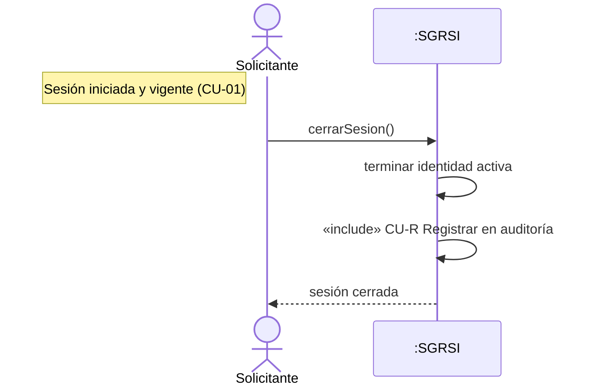

#### CU-03 Reportar incidencia

1. El actor indica el referente (un equipo, una ubicación o ambos).
2. Indica la categoría.
3. Indica la prioridad.
4. Escribe el título y el detalle.
5. El sistema valida el referente y la extensión del texto, y registra la incidencia **pendiente**.
6. «include» CU-N: el sistema devuelve el identificador como acuse.
7. «include» CU-R.

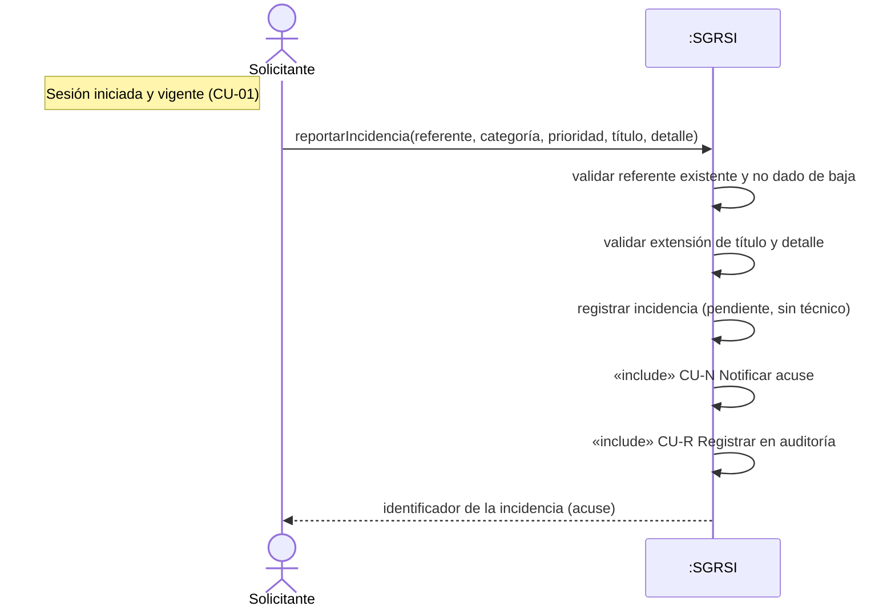

#### CU-04 Consultar mis pedidos

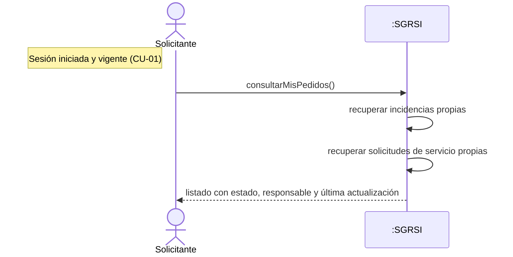

#### CU-05 Solicitar préstamo

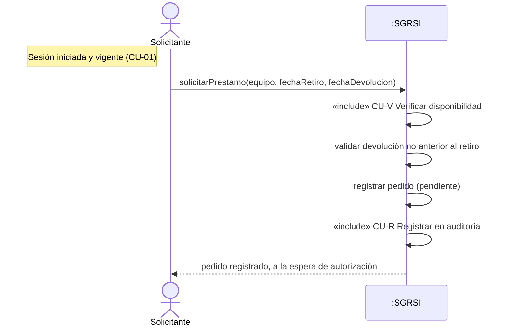

#### CU-06 Solicitar servicio

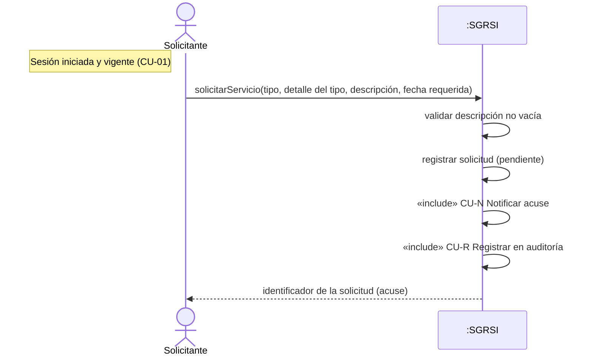

#### CU-07 Consultar inventario

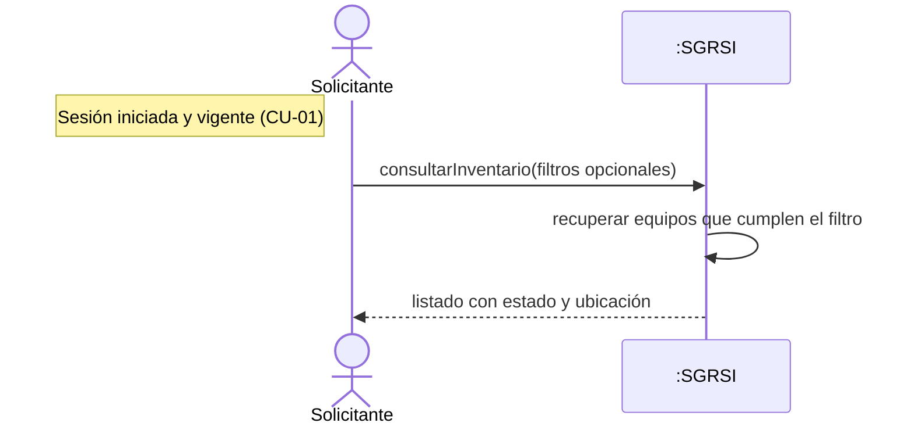

---

### 4.2 Técnico

Nota de precondición en todos: *Sesión iniciada y vigente (CU-01) con rol Técnico o superior*.

#### CU-08 Registrar equipo

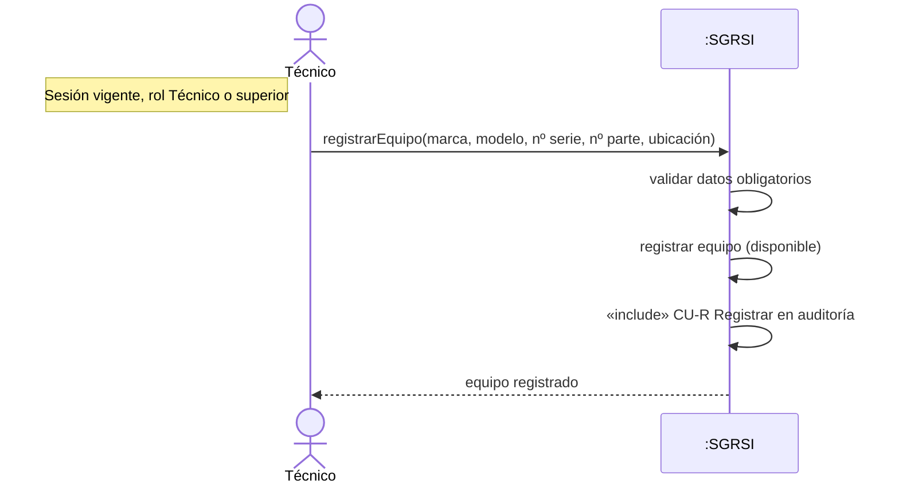

#### CU-09 Dar de baja equipo

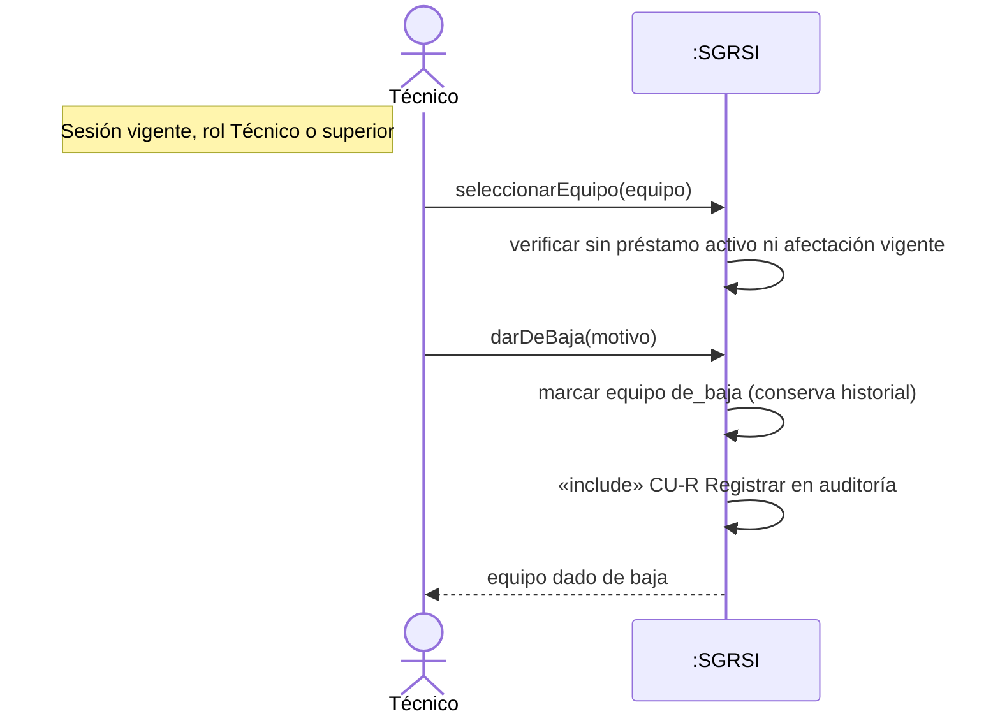

#### CU-10 Registrar falla

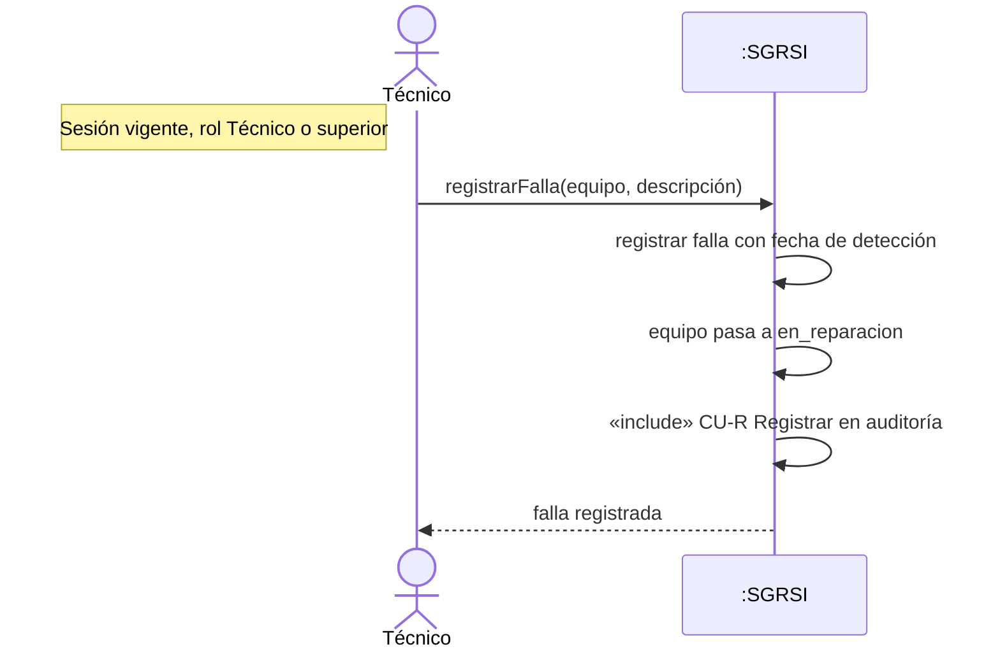

#### CU-11 Tomar incidencia

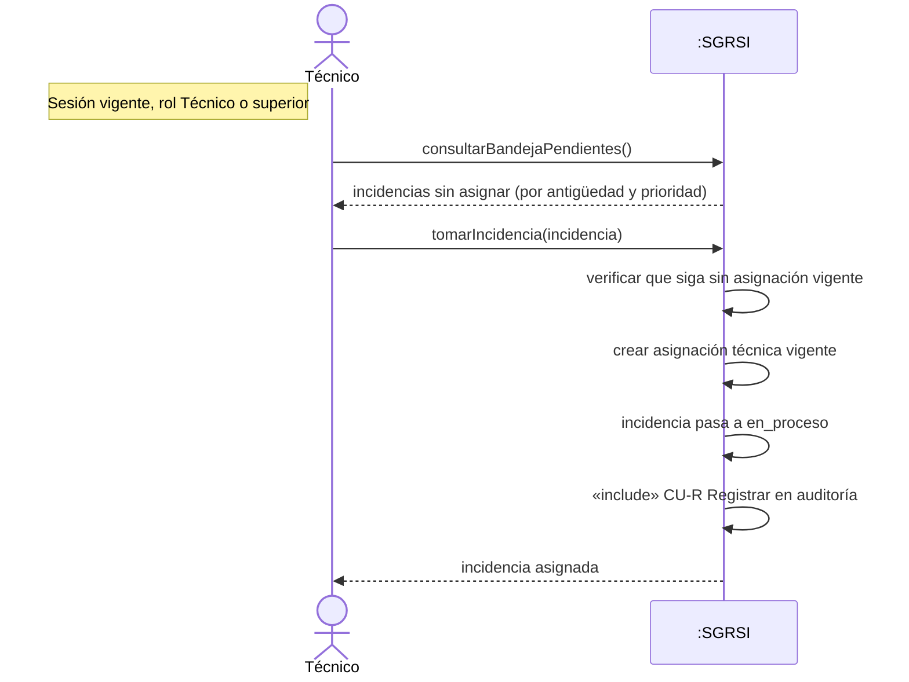

#### CU-12 Diagnosticar incidencia

```mermaid
sequenceDiagram
    actor T as Técnico
    participant SG as :SGRSI
    Note left of T: Sesión vigente; incidencia en_proceso asignada al técnico
    T->>SG: diagnosticar(incidencia, causa)
    SG->>SG: validar asignación vigente al técnico (o rol admin)
    SG->>SG: registrar diagnóstico con fecha
    SG->>SG: incidencia pasa a en_resolucion
    SG->>SG: «include» CU-R Registrar en auditoría
    SG-->>T: diagnóstico registrado
```

*(Las extensiones CU-10 y CU-14 no forman parte del camino feliz.)*

#### CU-13 Resolver incidencia

```mermaid
sequenceDiagram
    actor T as Técnico
    participant SG as :SGRSI
    Note left of T: Sesión vigente; incidencia en_resolucion asignada al técnico
    T->>SG: resolver(incidencia, accionesTomadas, corregido)
    SG->>SG: validar diagnóstico previo
    SG->>SG: validar acciones no vacías
    SG->>SG: incidencia pasa a resuelto, fija fecha
    SG->>SG: cerrar asignación técnica vigente
    SG->>SG: «include» CU-R Registrar en auditoría
    SG-->>T: incidencia resuelta
```

#### CU-14 Registrar nota técnica

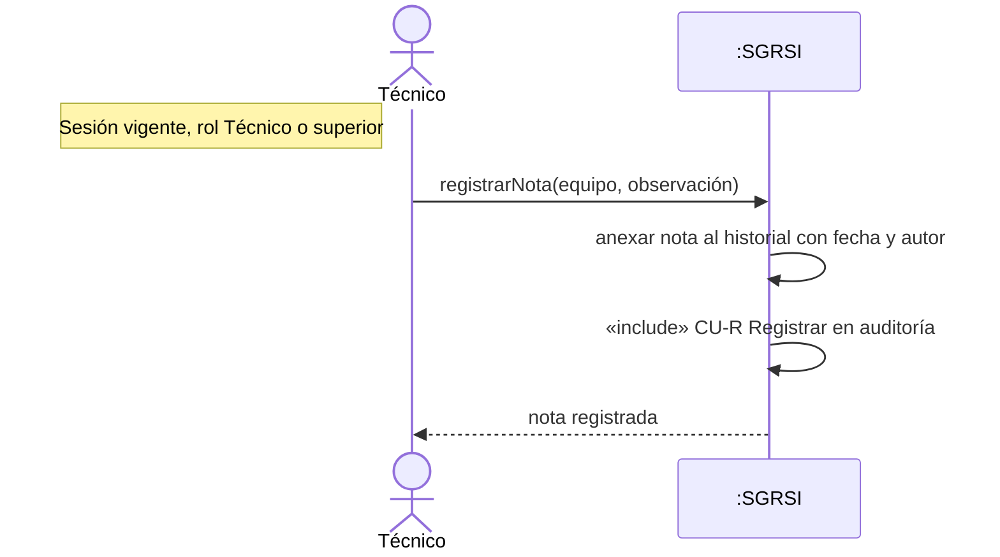

#### CU-15 Entregar equipo prestado

```mermaid
sequenceDiagram
    actor T as Técnico
    participant SG as :SGRSI
    Note left of T: Sesión vigente; préstamo en estado aprobado
    T->>SG: entregar(préstamo, componentesEntregados)
    SG->>SG: fijar fecha de entrega
    SG->>SG: préstamo pasa a activo
    SG->>SG: equipo pasa a en_uso
    SG->>SG: «include» CU-R Registrar en auditoría
    SG-->>T: entrega registrada
```

#### CU-16 Registrar devolución

```mermaid
sequenceDiagram
    actor T as Técnico
    participant SG as :SGRSI
    Note left of T: Sesión vigente; préstamo activo o vencido
    T->>SG: identificarPrestamo(equipo o solicitante)
    T->>SG: registrarDevolucion(componentesVerificados, condición sin falla)
    SG->>SG: fijar fecha de devolución real
    SG->>SG: préstamo pasa a devuelto
    SG->>SG: equipo pasa a disponible
    SG->>SG: «include» CU-R Registrar en auditoría
    SG-->>T: devolución registrada
```

#### CU-17 Ejecutar servicio

```mermaid
sequenceDiagram
    actor T as Técnico
    participant SG as :SGRSI
    Note left of T: Sesión vigente; solicitud en estado aprobada
    T->>SG: tomarSolicitud(solicitud)
    SG->>SG: registrar responsable, solicitud pasa a en_proceso
    Note over T: ejecuta la intervención
    T->>SG: registrarResultado(resultado)
    SG->>SG: solicitud pasa a completada con fecha
    SG->>SG: «include» CU-R Registrar en auditoría
    SG-->>T: servicio completado
```

---

### 4.3 Administrador

#### CU-18 Gestionar usuarios (alta)

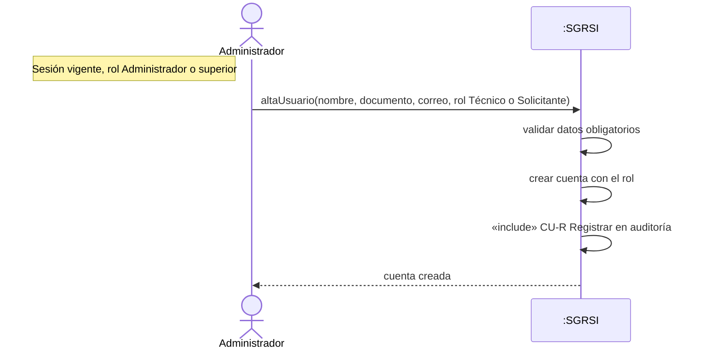

#### CU-19 Autorizar préstamo

```mermaid
sequenceDiagram
    actor A as Administrador
    participant SG as :SGRSI
    Note left of A: Sesión vigente, rol Administrador; pedido pendiente
    A->>SG: consultarPedidosPendientes()
    SG-->>A: pedidos pendientes
    A->>SG: seleccionarPedido(pedido)
    SG->>SG: «include» CU-V Verificar disponibilidad
    A->>SG: autorizar(pedido)
    SG->>SG: registrar autorización, responsable y fecha
    SG->>SG: pedido pasa a aprobado
    SG->>SG: «include» CU-R Registrar en auditoría
    SG-->>A: préstamo autorizado
```

#### CU-20 Resolver solicitud

```mermaid
sequenceDiagram
    actor A as Administrador
    participant SG as :SGRSI
    Note left of A: Sesión vigente, rol Administrador; solicitud pendiente
    A->>SG: consultarSolicitudesPendientes()
    SG-->>A: solicitudes pendientes
    A->>SG: aprobar(solicitud)
    SG->>SG: solicitud pasa a aprobada
    SG->>SG: «include» CU-R Registrar en auditoría
    SG-->>A: solicitud aprobada
```

#### CU-21 Reasignar incidencia

```mermaid
sequenceDiagram
    actor A as Administrador
    participant SG as :SGRSI
    Note left of A: Sesión vigente, rol Administrador; incidencia con asignación vigente
    A->>SG: reasignar(incidencia, técnicoDestino, motivo)
    SG->>SG: cerrar asignación vigente con motivo
    SG->>SG: abrir nueva asignación al técnico destino
    SG->>SG: «include» CU-R Registrar en auditoría
    SG-->>A: incidencia reasignada
```

#### CU-22 Consultar indicadores

```mermaid
sequenceDiagram
    actor A as Administrador
    participant SG as :SGRSI
    Note left of A: Sesión vigente, rol Administrador o superior
    A->>SG: consultarIndicadores(período)
    SG->>SG: calcular indicadores sobre datos vigentes
    SG-->>A: tablero de indicadores
```

#### CU-23 Gestionar afectación (apertura)

```mermaid
sequenceDiagram
    actor A as Administrador
    participant SG as :SGRSI
    Note left of A: Sesión vigente, rol Administrador; equipo no dado de baja
    A->>SG: afectar(equipo, persona, motivo)
    SG->>SG: verificar sin afectación vigente ni préstamo activo
    SG->>SG: registrar afectación abierta con fecha de inicio
    SG->>SG: «include» CU-R Registrar en auditoría
    SG-->>A: afectación registrada
```

---

### 4.4 Administrador raíz

#### CU-24 Auditar sistema

```mermaid
sequenceDiagram
    actor R as Administrador raíz
    participant SG as :SGRSI
    Note left of R: Sesión vigente, rol Administrador raíz
    R->>SG: consultarAuditoria(fecha, usuario, entidad)
    SG->>SG: recuperar entradas que cumplen el filtro
    SG-->>R: registro (operación, entidad, responsable, momento)
```

*(No incluye CU-R: leer la auditoría no se audita, RN-45.)*

#### CU-25 Gestionar cuentas administrativas (alta)

```mermaid
sequenceDiagram
    actor R as Administrador raíz
    participant SG as :SGRSI
    Note left of R: Sesión vigente, rol Administrador raíz
    R->>SG: altaCuentaAdministrativa(datos, rol Administrador o Administrador raíz)
    SG->>SG: validar datos obligatorios
    SG->>SG: crear cuenta con el rol
    SG->>SG: «include» CU-R Registrar en auditoría
    SG-->>R: cuenta administrativa creada
```

---

### 4.5 Reloj

#### CU-26 Vencer préstamo

```mermaid
sequenceDiagram
    actor C as Reloj
    participant SG as :SGRSI
    Note left of C: No autentica; se dispara por intervalo
    C->>SG: transcurre intervalo de verificación
    SG->>SG: identificar préstamos activos con fecha pactada vencida
    SG->>SG: pasar cada uno a vencido
    SG->>SG: «include» CU-R (atribuido al sistema)
```

#### CU-27 Expirar sesión

```mermaid
sequenceDiagram
    actor C as Reloj
    participant SG as :SGRSI
    Note left of C: No autentica; se dispara por inactividad
    C->>SG: transcurre plazo de inactividad
    SG->>SG: identificar identidades activas vencidas
    SG->>SG: terminar cada identidad
    SG->>SG: «include» CU-R (atribuido al sistema)
```

---

## 5. Diferencias entre el modelo y lo implementado

### 5.1 Tabla de diferencias

Los diagramas **siguen al modelo** y no cambian. Esta tabla sirve para defender el diseño o
para corregir uno de los dos lados. Verificada contra `dev` @ `e9175a5`.

| Tema | Modelo (vault) | Implementación hoy en `dev` |
|---|---|---|
| Referencia de código | El issue #47 comparaba contra `lux-1` (front con MSW) | Hay backend real: Bun + Elysia + GraphQL Yoga + Drizzle sobre PostgreSQL (`api/`); MSW queda solo para desarrollo |
| CU-03 Reportar incidencia | Prioridad, referente equipo **o ubicación**, validación de extensión | `TicketInput` solo acepta título, descripción, categoría y equipo opcional: no hay prioridad ni ubicación del referente, y no se valida la extensión mínima (RN-04) |
| CU-04 Consultar mis pedidos | Listado propio de incidencias y solicitudes | Además del listado, el solicitante tiene **inicio propio** (`RequesterHome`) con sus métricas y accesos rápidos; también ve sus préstamos |
| CU-05 Solicitar préstamo | Lo hace el Solicitante | **Ya resuelto**: "Préstamos" está en el menú del solicitante y el botón pasa a «Solicitar préstamo» (el staff ve «Registrar préstamo»); el servidor fuerza `userId = caller.id` para quien no es staff |
| CU-06 Solicitar servicio | Incluye **fecha requerida** | `ServiceRequest` no tiene fecha requerida; se guardan tipo, descripción, laboratorio, software y equipo |
| CU-08 Registrar equipo | Marca, modelo, nº de serie, nº de parte, ubicación | Se agregan `machineId` (la UI lo sugiere con el tipo y el código de ubicación, p. ej. `L1-PC3`, y se puede editar) y el tipo; la UI ofrece `available` o `in_repair` como estado inicial |
| CU-09 Dar de baja equipo | Verifica "sin préstamo activo ni afectación vigente" | Bloquea si hay préstamo en curso, **tickets abiertos** o reservas vigentes; marca `retired` + `deletedAt` (baja lógica) |
| CU-10 Registrar falla | Caso propio; el equipo pasa a en_reparacion | No existe la entidad falla: se registra como intervención correctiva o en el texto `issues` del equipo. `updateProduct` **no** cambia el estado: `in_repair` solo se pone al dar de alta o al devolver un préstamo con daños |
| CU-12 → CU-13 | Diagnosticar pasa a en_resolucion y después se resuelve | Se puede hacer en dos pasos (`changeTicketStatus` a `in_resolution`), pero el asistente de 5 pasos guarda el diagnóstico y resuelve en un solo `completeTicket`; `changeTicketStatus` rechaza `resolved` |
| CU-14 Registrar nota técnica | Caso propio | Implementado como **intervención** sobre el equipo (`createIntervention`: tipo, descripción, repuestos, fecha), visible en el historial del equipo |
| CU-15 Entregar equipo prestado | Incluye comprobante | Sin comprobante en PDF (RF-PRES-003) |
| CU-18 Gestionar usuarios | Alta limitada a Técnico o Solicitante | `ASSIGNABLE_ROLES` permite también **Administrador**; `root_admin` nunca se asigna y no se puede editar ni desactivar |
| CU-19 Autorizar préstamo | Solo Administrador; nadie autoriza su propio pedido | Cualquier staff (incluido Técnico) aprueba o rechaza (`approveLoan`/`rejectLoan` exigen `STAFF_ROLES`); nada impide autorizar el propio pedido (RN-17) |
| CU-20 Resolver solicitud | Solo Administrador | Cualquier staff cambia el estado (`updateServiceRequest`); además se permite `pending → completed` sin pasar por `approved` |
| CU-21 Reasignar incidencia | Cierra la asignación con motivo | `assignTicket`/`assignServiceRequest` cambian el responsable, pero **no** guardan el motivo de la reasignación |
| CU-22 Consultar indicadores | Tablero | `dashboardStats` + `reports`; exportación **CSV** de reportes, sin PDF ni XLSX (RF-DASH-005) |
| CU-23 Gestionar afectación | Caso propio | **No implementado**: no existe la entidad afectación permanente |
| CU-24 Auditar sistema | Solo Administrador raíz | El log lo ven `admin` **y** `root_admin` (`ELEVATED_ROLES`); consulta y filtros sí, exportación CSV no |
| CU-25 Cuentas administrativas | El raíz crea Administradores | El mismo formulario de usuarios ofrece `admin` a cualquier administrador; no hay pantalla separada de cuentas administrativas |
| CU-26 Vencer préstamo | Proceso programado por intervalo | No hay proceso programado: el vencimiento se evalúa **en cada lectura** (`syncOverdueLoans`) y genera el aviso `overdue` para el solicitante y quien aprobó |
| CU-27 Expirar sesión | Expira por inactividad | No hay expiración por inactividad: el JWT vence a las **8 h fijas** (`TOKEN_TTL`) y `logout` revoca el `jti`; cambiar la contraseña sube `token_version` y corta las sesiones anteriores |
| Reservas | No hay caso de uso | Existe el módulo Reservas (equipo o espacio): pedir, aprobar, rechazar, editar y cancelar, con avance automático `approved → active → completed` |
| Notificaciones | Solo CU-N (acuse al solicitante) | Tabla `notices` + `pendingNews`: avisos por persona y elemento (asignado, aprobado, resuelto, vencido, comentario…), marcables como vistos |
| i18n | No está en el modelo | La app tiene español e inglés con selector persistente (ver [`I18N.md`](I18N.md)) |
| Rol "Administrador raíz" | Actor del modelo | En la UI se llama **Super Admin** (`ROLE_LABELS.root_admin`); en la API es `root_admin` |
| Nombres de estado | Español (`en_proceso`, `de_baja`, …) | Inglés en el código (`in_progress`, `retired`, …); equivalencias en la sección 2.2 |

### 5.2 Estado y operación real por caso de uso

Estado tomado de [`tests/cases/catalog.ts`](../tests/cases/catalog.ts) (correspondencia
CU → RF). Las operaciones son las del SDL de
[`api/src/graphql/schema.ts`](../api/src/graphql/schema.ts).

| CU | Operación / mecanismo en la API | Estado |
|---|---|---|
| CU-01 | `login(dni, password)` | implementado |
| CU-02 | `logout` (revoca el `jti` en `revoked_tokens`) | implementado |
| CU-03 | `createTicket(input)` | parcial |
| CU-04 | `tickets`, `serviceRequests`, `loans` (filtrados por el servidor según el rol) | implementado |
| CU-05 | `createLoan(input)` | implementado |
| CU-06 | `createServiceRequest(input)` | implementado |
| CU-07 | `products(status, locationId, …)` | implementado |
| CU-08 | `createProduct(input)` | implementado |
| CU-09 | `softDeleteProduct(id)` | implementado |
| CU-10 | `createIntervention(input)` + `updateProduct(issues)` | parcial |
| CU-11 | `oolTickets` + `claimTicket(id)` | implementado |
| CU-12 | `changeTicketStatus(id, "in_resolution")` / `completeTicket` | implementado |
| CU-13 | `completeTicket(id, {diagnosis, corrected, actionsTaken})` | implementado |
| CU-14 | `createIntervention(input)` | implementado |
| CU-15 | `deliverLoan(id)` | parcial |
| CU-16 | `returnLoan(id, damaged, issues)` | implementado |
| CU-17 | `claimServiceRequest(id)` / `assignServiceRequest` + `updateServiceRequest(status, resolutionText)` | implementado |
| CU-18 | `createUser(input)` | implementado |
| CU-19 | `loans(status: "pending")` + `approveLoan(id)` / `rejectLoan(id, reason)` | parcial |
| CU-20 | `serviceRequests(status: "pending")` + `updateServiceRequest(id, {status})` | implementado |
| CU-21 | `assignTicket(id, technicianId)` / `assignServiceRequest(id, technicianId)` | implementado |
| CU-22 | `dashboardStats(period)` + `reports` | parcial |
| CU-23 | — | no implementado |
| CU-24 | `activityLogs(userId, operation, startDate, endDate)` | parcial |
| CU-25 | `createUser` con `role: "admin"` | parcial |
| CU-26 | `syncOverdueLoans` (implícito en cada lectura), aviso `overdue` | implementado |
| CU-27 | `TOKEN_TTL` de 8 h + `logout` | parcial |
| CU-V | `hasOpenLoan` / `equipment.status` en `createLoan`, `approveLoan`, `createReservation` | implementado |
| CU-N | `notices` + `pendingNews` | implementado |
| CU-R | `writeAudit` dentro de la transacción de cada mutación | implementado |

Estado agregado: **18 implementados**, **8 parciales** (CU-03, CU-10, CU-15, CU-19, CU-22,
CU-24, CU-25, CU-27) y **1 no implementado** (CU-23).

---

## 6. Checklist

### 6.1 Para quien dibuja

- [ ] 7 secuencias del Solicitante (CU-01 a CU-07)
- [ ] 10 secuencias del Técnico (CU-08 a CU-17)
- [ ] 6 secuencias del Administrador (CU-18 a CU-23)
- [ ] 2 secuencias del Administrador raíz (CU-24, CU-25)
- [ ] 2 secuencias del Reloj (CU-26, CU-27)
- [ ] Revisar que cada CU-R / CU-N / CU-V dibujado coincida con la lista cerrada de la sección 2.2 del vault
- [ ] Exportar a SVG y terminarlo en draw.io con el estilo de `07-ASSETS/Diagramas/PorActor/`
- [ ] Revisar los diagramas de CU-23, CU-26 y CU-27: el primero no está implementado y los otros dos difieren del mecanismo real (sección 5)

### 6.2 Verificación de este documento

- [x] Las 27 secuencias están presentes, numeradas CU-01 a CU-27, sin duplicados ni saltos
- [x] Cada bloque Mermaid abre con `sequenceDiagram`, declara sus participantes y cierra su bloque
- [x] Los nombres de actor y rol coinciden con `src/lib/roles.ts` y `api/src/lib/roles.ts`
- [x] Los nombres de estado coinciden con `src/lib/constants.ts` y `api/src/lib/types.ts`
- [x] Todas las operaciones GraphQL citadas existen en el SDL de la API
- [x] Los enlaces relativos del documento apuntan a archivos existentes del repo

---

## 7. Cómo renderizar y mantener

1. Pegar cada bloque en <https://mermaid.live> para verlo; exportar a SVG.
2. Terminar el dibujo en draw.io con el estilo del vault.
3. Si cambia el modelo (vault), actualizar el diagrama y la fecha de revisión.
4. Si cambia el código, revisar la sección 5: es lo único que ata este documento a la
   implementación.

No hay Mermaid CLI en el repo ni como dependencia, así que la validación de sintaxis es
manual: alcanza con no romper la forma `actor|participant ... as ...`, las flechas
(`->>`, `-->>`) y los `Note ... of ...:`.

---

## 8. Referencias

- Issue de origen: [#47](https://github.com/wefaber/lux/issues/47)
- Modelo: `eternum-vault/02-INGENIERIA-SOFTWARE/E2/UML-CasosDeUso.md` y `UML-Estados.md`
- Diagramas de casos de uso: `eternum-vault/07-ASSETS/Diagramas/`
- Arquitectura y capas: [`ARQUITECTURA.md`](ARQUITECTURA.md)
- Backend, operaciones GraphQL y permisos: [`BACKEND.md`](BACKEND.md)
- Internacionalización: [`I18N.md`](I18N.md)
- Estados y transiciones en el frontend: [`../src/lib/constants.ts`](../src/lib/constants.ts)
- Esquema de la base: [`../api/src/db/schema.ts`](../api/src/db/schema.ts)
- Schema legado (MariaDB): [`sql/proyecto.sql`](sql/proyecto.sql)
